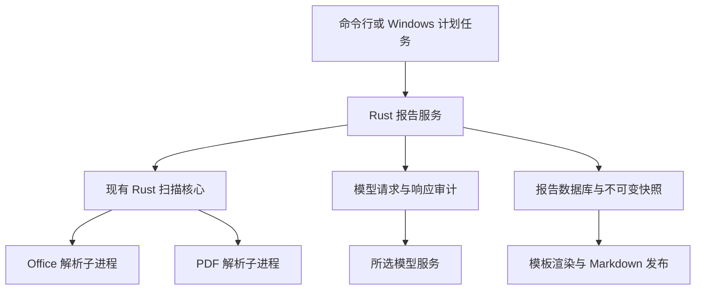

# AI Daily Report Rust 统一实现产品计划书

文档版本：1.4
规划日期：2026 年 10 月 14 日\
更新日期：2026 年 10 月 15 日\
适用平台：Windows x64\
业务时区：Asia/Shanghai

将现有审计日报生成器建设为无需 Python 环境即可安装、运行和维护的 Rust 产品，同时改善日报的主题组织、通俗表达和关键细节。完整保留文件证据采集、日报周报月报、模型调用记录、历史补跑、失败恢复与定时交付能力，复用已经投入使用的 Rust 扫描和 Office 解析核心。

交付结果是一套经过安装验证的 Windows 程序包：用户配置工作目录和模型连接后，可以生成按事项展开、关键条件与状态明确、有来源依据的报告，查看未覆盖内容，并在异常中断后继续处理。程序包包含必要的解析子进程、原生库、模板和操作工具。

具体任务、改动位置与验证命令见 [Rust 统一实现执行计划](2026-10-14-rust-execution-plan.md)。实现采用单一解析路径和集中重试，控制工程拆分与兼容分支数量。

## 一 产品定位与目标

### 服务对象

主要使用者是需要整理工作证据、编写审计日报及周期总结的个人用户。产品同时作为一个可持续维护的 Rust 实践项目，使维护者能够理解从文件输入、模型处理到报告交付的完整实现。

日常使用继续采用命令行和 Windows 任务计划程序。工作文件、数据库、运行记录及报告保存在本地；只有现有业务规则允许发送的内容进入所选模型服务。

### 核心目标

| 目标 | 完成后的实际变化 | 判定方式 |
| --- | --- | --- |
| 统一生产技术栈 | 报告业务、扫描、解析调度和运行工具由 Rust 实现 | 生产依赖链与交付包中不需要 Python、虚拟环境或 PyO3 |
| 简化安装与维护 | 交付可直接运行的版本化程序包，配置与数据独立保存 | 在无 Python 的 Windows 环境完成安装、自检、生成和恢复 |
| 保留产品能力 | 日报、周报、月报、补跑、审计与恢复继续可用 | 功能清单与现有行为逐项对应，关键异常路径通过测试 |
| 提高实现可理解性 | 参数、业务状态、错误和数据结构有清晰的 Rust 类型 | 维护者能沿同一条 Rust 调用链解释输入、处理与输出 |
| 保持报告可信度 | 来源、实际读取范围、未覆盖内容及模型调用可以核对 | 通用解析语料、固定响应回放和真实调度验收通过 |
| 日报易读且细节充分 | 按工作事项说明背景、材料中的处理内容、关键依据和当前状态；同一事实集中表达 | 通用内容样本覆盖主题归并、术语解释、关键条件保留与证据不足场景 |

性能按同机、同输入、同配置进行测量。语言迁移不预设报告耗时或模型成本的降幅，内容质量通过解析、来源覆盖及报告规则单独验证。

## 二 用户场景与产品行为

### 每日自动交付

Windows 任务计划程序按既有调度规则启动程序。程序确定目标自然日，扫描获准目录，提取文件证据，准备并保存模型输入，生成报告，提交数据库并发布 Markdown 文件。

手动日报默认处理前一个已经结束的自然日；`--scheduled` 沿用“最近已到交付时点”的目标日规则。跨午夜恢复继续使用原运行的目标日期和冻结输入。当前每日 09:00 的调度安排在切换时保留。

用户能够同时看到执行结果、报告质量和覆盖限制。执行成功与内容完整度分别记录：一份已经成功交付的报告可以因文件解析或输入范围限制而标记为 `partial`。

### 日报内容与阅读体验

日报用于帮助用户回顾材料涉及的工作事项、具体内容和需要处理的问题。正文采用“内容概览 → 按事项展开 → 待确认事项 → 来源与覆盖附录”的顺序。概览通常为 3 至 5 条，材料较少时按实际数量呈现；重点事项按需要展开，不用统一的 180 字限制压缩完整业务关系。

- 每个事项有清楚的标题，集中说明材料中的背景或问题、具体处理内容、关键数据与条件、方案或结果状态。原文没有提供的背景、效果、责任人和下一步安排保持缺省，不补写套话。
- 同一事项下合并重复事实，保留不同版本、主体、期间和口径的差异。数字必须带含义、单位和期间；必要的例外、同时满足条件与并行关系完整保留。数据较多时使用小表格。
- 专业术语首次出现时给出简短解释，直接使用“拟议方案”“现行规则”“材料记载的结果”等具体状态。历史补录保留日期归档与观察时间说明；文件最后修改日期不能证明当天完成了相关工作。
- 来源引用留在对应事实旁。正文只保留影响理解的覆盖说明，字符数、读取范围、校验值与技术错误详情集中放入附录；正文和附录保存在同一报告中。
- 待确认事项只包括来源显示的具体矛盾或未决业务问题。解析失败、材料缺失和只读到局部内容在覆盖说明中表达，不能扩写成业务事实。

生成流程采用“完整分批提取事实 → 按容量成稿 → 合并并渲染”。成稿直接使用已冻结的事实及来源映射，完成主题归并、重复消除和通俗表达，不重新扫描、不追加外部检索。容量允许时一次完成，材料较多时按主题分组成稿，由 Rust 合并所有正文与待确认内容。复用已有模型调用、快照和恢复代码，不增加多轮评分或润色流程。事实提取保留背景、数字、条件和例外；输出截断后完整拆分并处理所有子批次，已成功部分可复用。

事实提取输出默认 16,384 token，与单次请求 160,000 字节分别设置。初始批次随输出容量控制规模，最多 32 批；全部摘录放不下时明确停止。每个选定摘录范围必须进入成功请求，每个已提取事实必须出现在正文或待确认中。原文件解析、摘录截取和文件大小限制仍分别说明，不能把模型阶段覆盖完整写成原文件全部覆盖。

报告内容质量与文件覆盖程度分别验收。新报告采用上述结构；已发布历史正文与哈希继续保留，历史输出修复使用原正文。历史样本用于发现通用问题，自动化验收使用合成或脱敏材料，不把公司原始内容写入测试或计划。

正文的详细程度由实际材料决定。验收核对重要背景、数据含义、适用条件、例外和状态是否讲清；不要求每个事项填满固定栏目，也不以总字数作为完成标准。材料充分时展开解释，材料不足时明确具体缺口。

### 生成前核对与预览

- `--dry-run` 只进行本地扫描和预检，允许记录扫描清单与缓存，模型调用为零。
- `--no-save` 生成模型预览并保留调用审计，正式报告及当前版本指针保持原状。
- `--regenerate --reason` 明确表达重新生成的意图，保留原因与原版本。
- 用户主动输入参与模型处理；日期附注保持现有本地合并语义。

### 周期总结与历史补跑

周报和月报继续支持历史数据库聚合与文件扫描两种来源。历史补跑先固定日期、来源和输入，再执行模型调用；候选报告与正式发布分开，已经成功的响应按原请求身份复用。

覆盖修复保留原作业身份、来源范围和调用记录。历史优先级仅影响经过身份校验的文件内容分配，旧摘要不能替代本次原文证据。

### 异常恢复与输出修复

已经保存的模型结果优先复用。缺失批次按原有恢复规则继续执行，未知结果保留为未知并保留已发生的尝试记录。对已经提交数据库的报告，`repair-output` 使用已存正文恢复文件，不重新扫描，也不调用模型。

## 三 完整交付范围

下列能力共同构成 Rust 生产版的交付范围。工作包用于安排实施依赖，最终验收覆盖全部能力。

| 编号 | 能力 | 交付要求 |
| --- | --- | --- |
| F01 | 命令行与配置 | 保留现有子命令、重要参数、退出码和配置覆盖规则；错误提示能够定位到配置项或操作 |
| F02 | 扫描与上下文 | 复用文件发现、分类、缓存、预算分配、审计及确定性压缩；保留来源身份和实际读取范围 |
| F03 | 文本与 Office | 保留文本、CSV、JSON、日志及已确认的 Office 能力；将必要内容能力补入对应 Rust 主解析器，覆盖真实 XLS 和扩展名与内容不一致的文件 |
| F04 | PDF | 完成分类、选页、文本提取、页级证据和失败诊断；覆盖中文、混排、图文混合、扫描页、加密及损坏文件 |
| F05 | 模型调用 | 保留服务提供方、网关设置、结构化输出、分批、重试、超时、截断恢复及调用用量记录 |
| F06 | 日报周报月报 | 保留日期、来源与正式版本规则；日报按事项成稿并解释关键细节，周月报保留聚合语义 |
| F07 | 历史与恢复 | 保留运行阶段、快照、成功响应复用、失败修订、部分成功恢复和历史查询 |
| F08 | 补跑与覆盖修复 | 将生产使用的 Python 操作脚本能力收口到 Rust 命令行，保留准备、候选生成和发布边界 |
| F09 | OCR 接入 | 保留 OCR（图片文字识别）结果导入、原文件身份校验和未核实文字标识；通过受限子进程协议接入现有获准引擎 |
| F10 | 任务与运维 | 保留计划任务预览、显式应用、读取核对、运行自检、日志及单实例控制 |
| F11 | 安装与回退 | 提供完整程序包、文件哈希清单、依赖说明、升级检查和验证过的回退操作 |

文件支持范围以现有配置、实际解析行为和测试共同确定。`.doc`、`.ppt` 延续默认关闭，保留显式启用后的解析能力。用户允许在替代完成后移除对应旧实现：同一批真实二进制 DOC/PPT 文件通过 Rust 内容、输出限制与错误处理验证，扫描链改用 Rust 后，移除对应 Python 解析路径及专属依赖。未知格式应返回明确诊断，不能生成看似成功的空内容。

本次交付保持现有操作入口与部署平台。新增图形界面、多用户协作、云端托管及自研 OCR 引擎需要单独的产品需求。

## 四 推荐架构与技术方案

### 整体结构

主程序组织业务。扫描核心负责证据采集与上下文构建。复杂文件解析继续放在独立子进程中，使用既有超时、内存约束和进程回收能力，隔离解析器故障。

每种受支持格式使用一条解析路径，失败后记录原因和覆盖限制。模型网络请求集中在一处执行和重试，不自动更换解析引擎、模型或服务商。输入校验放在系统边界，事务、证据完整性和必要恢复保护继续保留。

### 工程边界

| 工程部分 | 职责与处理方式 |
| --- | --- |
| 现有扫描与共享类型 | 复用 `scanner_core`、`scanner_contract`、`worker_contract` 和 `discovery`，保留已经验证的职责划分 |
| 现有 Office 解析器 | 复用 `office_parser`；补齐 XLS 与必要内容能力，继续限制读取行列、段落、幻灯片及输出规模 |
| 新增 `report_app` | 同一工程包包含业务库与命令行，容纳请求、状态、配置、模型调用、存储、快照、模板与发布；生成 `ai-daily-report.exe` |
| 新增 `pdf_parser` | 使用 Rust 调用 PDFium，提供分类与提取能力，在独立进程内执行 |

仅新增上述两个工程包。`report_app` 内按职责划分普通模块，直接调用具体实现；只为模型网络测试替身保留必要接口，不增加插件系统、依赖注入容器或通用流程引擎。

生产调用链直接使用 Rust 扫描接口。同步解除配置、自检、能力握手、构建身份及发布脚本对 Python 路径和解释器身份的硬绑定，移除生产链中的 `scanner_native` 与 PyO3。

### 库与组件选择

| 能力 | 采用方案 | 选择理由与验收重点 |
| --- | --- | --- |
| 参数解析 | `clap` | 生成参数校验和帮助；保留现有命令语义与退出行为 |
| 配置 | `serde` 与 `serde-saphyr` | 读取 YAML 到明确类型；验证递归合并、环境变量、空值与默认值行为 |
| 模型通信 | `reqwest` 阻塞客户端与受限并发任务 | 直接发送冻结后的请求正文；应用层统一负责重试，关闭自动重定向及隐式重试 |
| 报告存储 | 复用 `rusqlite` | 延续 SQLite 事务、备份和单实例约束，避免增加数据库服务 |
| 模板 | `minijinja` | 复用现有 Jinja2 模板写法；逐模板验证过滤器、未定义值、空白与换行行为 |
| PDF | `pdfium-render` 与随包固定版本的 PDFium | 复用成熟 PDF 引擎；独立验证文本顺序、中文、原生库分发和异常隔离 |
| XLS | `calamine` | 处理真实二进制 XLS；保留现有有界 XLSX 主路径，不因库切换扩大读取范围 |
| OOXML 内容补齐 | 复用 `office_oxide`、`quick-xml` 与 `zip` | 将必要内容能力补入对应主解析路径，保留表格、备注与范围审计 |
| 旧版 DOC/PPT | 复用现有 `office_oxide` 读取模块 | 完成协议与路由接入，以真实二进制样本验证替代；验证通过后移除对应 Python 实现 |

官方资料确认了这些组件对应的基础能力：[clap](https://docs.rs/clap/latest/clap/)、[serde-saphyr](https://docs.rs/serde-saphyr/latest/serde_saphyr/)、[reqwest](https://docs.rs/reqwest/latest/reqwest/blocking/)、[MiniJinja](https://docs.rs/minijinja/latest/minijinja/)、[PDFium Rust 接口](https://docs.rs/pdfium-render/latest/pdfium_render/)、[calamine](https://docs.rs/calamine/latest/calamine/)。

新增依赖在实施时完成版本固定、Windows 构建验证和许可证检查，并进入锁文件与交付清单。PDFium 的底层实现为 C++；Rust 统一实现的交付目标允许这类原生库，生产运行不包含 Python 依赖。

### PDF 与 Office 的质量要求

PDF 分类和提取统一使用同版引擎，保留分类采样页与实际提取页两份记录。按选定页输出文字与来源范围；只有扫描图像的页面应正确标识，OCR 文字继续保留未核实状态。

PDFium 输出可能与现有 `pdfplumber` 的文本顺序和空白不同。使用通用合成语料验证中文、数字、段落顺序、页码、图文混合和范围限制，不能只凭“能够打开 PDF”判定迁移完成。历史 `pdf-extract` 候选测试记录仅作为识别中文解析风险的依据。

XLS 先根据文件内容识别真实格式。扩展名为 `.xls` 的 XLSX 进入相应路径；真实二进制 XLS 使用对应解析器。金额、日期、公式缓存值和行列范围按既有报告使用方式处理，原文中的编号和数字文本保持含义。

对可能需要整表加载的旧格式，执行输入文件大小、子进程内存和截止时间限制。输出行数限制只约束摘录规模，实际解析资源消耗需要单独测量与控制。

删除 Python 兼容解析路径的前提是：旧版成功的通用案例已有 Rust 对应实现，受控失败案例仍有明确诊断，解析边界与资源限制完成回归。缺少替代能力时，该工作包不能通过验收。

## 五 接口 数据与兼容规则

### 对外命令与内部接口

主程序保留 `daily`、`weekly`、`monthly`、`list`、`runs`、`repair-output`、`doctor` 及已有别名。日常参数含义保持一致，调用方式由 Python 入口变为 `ai-daily-report.exe`。

生产维护能力统一增加 `backfill`、`coverage`、`ocr`、`task` 命令组。分别承载历史补跑、覆盖修复、OCR 结果导入和任务配置；沿用现有准备、执行、发布及读取核对边界。所有现有生产脚本调用方都必须迁移到新入口。

Rust 业务入口采用 `run_report(request, app) -> Result<ReportOutcome, ReportError>`。`ReportRequest` 区分日报、周报和月报；结果保留目标期间、执行状态、质量、报告正文、输出位置和调用统计。应用直接持有配置、存储和客户端，时间作为明确输入；模型测试替身支持固定响应回放及中断测试。

`RunPhase` 使用枚举表示运行阶段。`created`、`scanning`、`prepared`、`generating`、`db_committed`、`published` 的既有持久化含义保持可读。状态变更必须在事务及单实例约束下完成。

### 配置与模型请求

- 沿用 `settings.yaml`、`settings.windows.yaml`、`.secrets.yaml` 的加载顺序及现有环境变量语义，处理已有 `.env` 使用方式；凭据解析与普通配置导出分离。
- 继承部署时的有效配置。当前已部署配置为 `recovery.enforce_model_budgets: false`，迁移不得用示例文件默认值重新开启累计调用次数、token 或金额限制；用量审计继续保留。
- 单次输入体积、单次输出、重试次数、请求超时和整次运行截止时间继续执行。恢复不能重置已经发生的尝试与消耗；启用预算的其他配置也需保持原行为。
- 成稿属于正常生成步骤，其调用次数、输入输出用量与耗时计入现有记录。正常首次生成的调用数为事实提取批次数加实际成稿组数，截断拆分的父子调用同样入账；成功成稿可复用，无有效事实的日期由模板说明现状。所有组使用同一成稿路径。
- 保留模型请求中的结构化输出、思考模式及参数位置。发送的 JSON 正文必须与已冻结正文一致，不能让客户端自行移动或补充业务字段。
- 字符数、UTF-8 字节数和 token 分别统计。迁移时不能把 Python 字符数直接替换为 Rust 字符串字节长度。

### 历史数据与快照

语言迁移沿用现有报告数据库结构，支持已存在的日报、周报、月报、运行记录和调用记录。当前证据报告迁移版本为 `REPORT_DB_VERSION=1`；实现时冻结实际表结构与合法历史样本，不能仅凭版本号假定两库完全一致。

现有快照、请求、响应和报告以原字节保存。兼容当前快照版本及请求响应结构，保留原标识、哈希与来源范围。摘要指纹继续遵循已存在的规范 JSON 规则，特别测试对象键顺序、非 ASCII 字符、浮点数、空值与换行；不得以重新序列化改写旧证据。

扫描库继续遵循 v3 的版本约束。解析器、原生库、工作进程协议或预算策略发生变化时，必须更新相应身份，使旧解析缓存正确失效。新发布使用独立扫描库路径，原扫描库保留作回退依据。

### 模型恢复与报告发布

- 复用成功响应前核对原请求、响应快照、作业、日期及来源范围。拆分必须完成所有子批次，不能用局部成功代表完整处理；旧格式缩批结果仍按实际处理范围计入覆盖。
- 响应已收到但持久化失败时，不能在同一次错误处理里自动重发。未知结果继续计入既有尝试记录，并按原恢复规则处理；外部模型服务未提供幂等保证时，不承诺请求只执行一次。
- 先提交报告数据库，再发布 Markdown；文件哈希验证成功后更新当前正式版本。
- 保留外部编辑检测、冲突文件、原版本和输出修复能力。清理不得移除未完成运行所需快照、未知文件或用户修改。

报告质量值保留为 `complete`、`partial`、`no_changes`、`unavailable`，分别表示覆盖完整、存在已记录限制、没有变化、证据不可用。质量与运行成功或失败分别表达。

## 六 实施工作包与完成标准

实施按以下依赖推进。每个工作包的产物都进入最终交付，迁移期间使用独立运行目录和数据库副本验证。

| 工作包 | 主要任务 | 必须交付的结果 | 依赖 |
| --- | --- | --- | --- |
| M1 冻结行为与建立对照 | 整理 F01 至 F11、调用方、配置、数据版本和异常行为；完成 PDFium 中文解析及模板兼容性验证；生成脱敏固定输入与响应 | 功能与测试对应表、关键组件可行性结果、兼容样本、指纹样本、现状性能基线 | 无 |
| M2 统一类型与运行基础 | 建立 `report_app`；迁移参数、配置、日期、锁、存储、快照、状态和发布 | 可执行命令、自检、历史数据读取、零模型调用的恢复与发布回放 | M1 |
| M3 迁移全部报告业务 | 迁移模型请求、完整分批、覆盖审计、日报周报月报、补跑及覆盖恢复；完成事实提取、按容量成稿与可读模板，保留预算开关与网关行为 | 固定响应端到端回放和通用内容验收通过，所有生产操作具备 Rust 入口 | M2 |
| M4 完成无 Python 解析 | 接入 PDFium、XLS 与 Office 兼容路径；迁移 OCR 接入；解除扫描核心和自检中的 Python 依赖 | 通用格式与故障语料通过，解析身份与缓存隔离正确，交付链无 Python | M3 |
| M5 构建与切换验收 | 完成版本包、任务配置、无 Python 安装测试、数据库备份、回退演练和真实调度验收 | 验收矩阵全部通过，完成三个连续真实计划任务窗口及最终证据清单 | M4 |

产品负责人确认业务语义和最终输出；实现负责人完成代码、测试与交付证据；运行维护负责人核对切换目标、任务状态和恢复材料。同一维护者可以承担多个角色。项目按工作包完成情况安排进度，日历上线日期由实际资源和验收条件确定。

## 七 测试与产品验收

验收采用通用解析与故障语料、固定模型响应回放、独立数据副本及真实调度窗口。现有 Python 测试在迁移期间提供行为对照；对应规则迁入 Rust 测试，正式产品的构建、安装和验证链不依赖 Python。

| 编号 | 验收项 | 通过条件 |
| --- | --- | --- |
| A01 | 无 Python 运行依赖 | 本机独立包在清空继承环境、PATH 仅含 Windows System32 的条件下完成自检、日报周报月报及恢复，进程和加载库检查无 Python 依赖。2026-10-15 用户决定豁免全新 Windows 实测，本项按现有证据验收通过；全新系统实测未执行 |
| A02 | 功能完整性 | F01 至 F11 全部有对应自动化或操作验收记录，原生产调用方没有遗漏 |
| A03 | 日期与调度 | 默认昨日、指定日期、调度交付时点、跨午夜恢复和周月边界符合现有规则；目标时区正确 |
| A04 | 报告与模板 | 固定响应回放验证相同格式版本下的确定性字段和 Markdown 字节；通用材料的实际生成样例通过主题归并、关键细节、术语解释及事实状态验收；历史输出修复保持原哈希 |
| A05 | 文档解析 | 中文与英文 PDF、混排、图文混合、空白、加密、损坏、真实 XLS、误标 XLSX、真实二进制 DOC/PPT、DOCX 表格和 PPTX 备注均有明确预期并通过；内容范围记录真实 |
| A06 | 模型调用与预算 | 预检和离线回放零调用；事实提取与成稿的成功响应复用不新增预约；两步用量均入账，启用与关闭预算两种模式均正确；发送正文与冻结正文一致 |
| A07 | 中断与恢复 | 在输入冻结、发送、响应持久化、数据库提交、文件替换及发布标记处注入中断；恢复保留记录，不覆盖用户修改，不错误复用结果 |
| A08 | 数据兼容 | 旧报告、合法快照与调用账本可读；未知新版本受控拒绝；备份完整性及历史版本查询通过 |
| A09 | 隔离与资源限制 | 解析器超时、崩溃、内存超限、协议损坏与取消均可控；残留进程得到回收；失败文件不自动转交备用解析器 |
| A10 | 身份与缓存 | 解析器、引擎、预算或协议变化导致对应缓存失效；不变输入的冷热上下文保持一致，命中情况可解释 |
| A11 | 发布与回退 | 完整安装包、文件哈希、严格自检、任务单实例、备份和回退演练通过；回退保留新增报告与调用审计。按 2026-10-15 用户确认，旧任务只继续后续日期的旧格式生成，新 v3 日报及其未完成运行由保留的 Rust 包读取、汇总与恢复 |
| A12 | 真实调度 | 切换后连续三个真实每日触发窗口通过；每次核对目标日、退出状态、报告文件与数据库、来源和模型审计；手动及模拟触发单列 |

Rust 检查使用工作区测试、格式检查、严格 Clippy 检查和锁定依赖的发布构建。性能对照在同机同语料下分别测量冷扫描、缓存命中、固定响应完整报告、解析子进程峰值内存及程序包大小，每组至少五次，报告中位数与最慢样本。

A04 的内容验收在 T07 使用通用合成材料实际生成候选日报，人工核对主题重复、复杂条件、术语、数值口径、方案状态和材料缺失六类场景。保存输入、模型响应、成稿及核对结论；模板回放验证单独记录。内容验收作为开发检查，不加入每次日报运行流程，也不增加自动评分或反复润色。

性能比较先剔除网络模型时延的波动。对未改解析算法的路径，中位耗时增加超过 10% 或峰值内存增加超过 20% 时列为验收阻断项；样本过短时增加同组重复次数确认。由于解析覆盖发生必要变化产生的差异，必须单列收益、成本和测量结果，由产品负责人确认后才能接受。

## 八 交付 升级与回退

### 交付内容

完整发布包包含主程序、Office 和 PDF 解析子进程、固定版本原生库、默认模板、配置示例、版本及 SHA-256 清单、第三方依赖与许可证说明，以及安装、自检、任务配置和恢复操作说明。

配置、报告数据库、快照、日志与生成报告位于独立数据目录。程序升级不覆盖用户配置。发布与运维工具采用 Rust 和必要的 PowerShell 脚本，提供无控制台窗口的计划任务运行方式。

### 切换顺序

1. 使用通用语料及获准数据副本完成 M1 至 M4，生成候选发布包，通过无 Python 安装与固定响应回放。
2. 核对实际使用的版本、有效配置、计划任务和未完成作业。已准备的模型任务由其兼容版本处理，避免新旧版本同时恢复同一作业。
3. 在获准切换窗口停止新任务进入，使用 SQLite 备份接口保存报告库与扫描库，并保存快照、模板、配置及任务定义；验证备份完整性和哈希。
4. 部署新包，保留报告数据与调用账本，使用新的扫描库路径；执行严格自检后，将既有任务指向新入口并读取核对，保持单实例。
5. 完成三个连续真实调度窗口验收，记录每次运行身份、质量、来源、耗时和调用用量；全部通过后完成生产验收。

### 回退规则

回退恢复旧程序、配置和任务入口，并使用其对应的扫描库。报告数据库、模型调用记录和新增快照持续保留，不能用旧备份覆盖切换后的业务记录。

正式切换前验证旧程序对兼容结构中新增记录的可读性。2026-10-15 隔离核对发现旧 Python 能读取新增周月报，拒绝 v3 日报；用户已确认：回退后旧任务继续后续日期的旧格式生成，v3 日报的查询、周月汇总及未完成输入的恢复由保留的 Rust 包处理。不能用旧版本重新解释或改写新格式记录。数据库备份用于损坏恢复及核对，程序回退不等于删除新增业务历史。

## 九 风险与处理要求

| 风险 | 处理要求 | 阻止发布的情况 |
| --- | --- | --- |
| PDF 引擎更换影响中文与段落顺序 | 通用语料覆盖编码、排版、混合页及数字；记录读取范围与原生引擎身份 | 丢失必要内容、数字含义变化、范围记录错误或进程失控 |
| 原 Python 兼容解析仍有独有能力 | 将旧版成功案例逐项纳入格式矩阵，补齐 Rust 路径 | 为移除 Python 而减少已有成功解析能力 |
| JSON 或模板细节改变指纹 | 规范序列化和模板字节回放单独验证；保留旧证据原字节 | 相同请求被识别为新请求、历史响应不能正确复用 |
| 配置迁移改变模型行为 | 比较脱敏有效配置及实际发送正文，覆盖预算开关和参数位置 | 意外恢复累计预算限制、扩大调用或请求正文发生未声明变化 |
| 业务与数据恢复不完整 | 故障注入、单实例验证及回退演练；保持状态和质量分离 | 重复发布、错误覆盖、调用记录丢失或恢复重置消耗 |
| 原生库与运行包不匹配 | 固定版本、哈希和许可证清单，在完整安装环境验证 | 开发目录可运行但交付包无法独立启动或依赖不可分发 |

## 十 Rust 学习与长期维护

学习围绕实际工作包展开，每个主题对应一个可以运行的产品行为。

| 工作内容 | Rust 重点 | 可解释的产品结果 |
| --- | --- | --- |
| 命令与报告类型 | `struct`、`enum`、模式匹配 | 用户参数如何变成不同报告请求，哪些状态允许继续 |
| 文件与数据库 | 所有权、借用及自动释放 | 文件、连接和锁由谁管理，异常结束后怎样释放 |
| 错误与恢复 | `Result`、错误枚举、事务 | 哪些失败可以继续，哪些需要停止，如何保存恢复依据 |
| 模型与解析并发 | 线程、消息传递、共享状态约束 | 怎样同时处理多个任务并保持记录顺序与一致性 |
| 原生 PDF 引擎 | 外部函数接口与进程隔离 | Rust 如何调用现有引擎，怎样限制错误影响范围 |
| 数据兼容与验证 | 序列化、接口替身、固定输入测试 | 怎样证明改写后的请求、报告和恢复行为符合原规则 |

每个核心模块提供简短的输入、处理和输出说明。技术决策记录聚焦真实取舍，例如 PDF 引擎选择、状态转换、缓存身份和发布顺序；操作文档保持与当前可执行命令一致。

完整交付需要同时具备 Rust 源码、对应测试、生产程序包、兼容与回退证据，以及能够解释关键调用链的维护说明。

## 依据与关联资料

- [当前架构与命令约定](../../README.md)：Rust 入口、扫描路由、数据边界及切换前保留的旧运行环境。
- [日报操作与恢复](../daily-report-operations.md)：日期、补跑、模型调用、覆盖修复及恢复语义。
- [Windows 部署约定](../windows-deployment.md)：发布包、自检、切换与回退要求。
- [当前覆盖优化状态](../coverage-optimization-v27-status.md)：已部署预算开关与通用能力验收口径。
- [报告运行与发布实现](../../src/services/report_runner/evidence_daily.py)：冻结输入、响应复用、报告阶段及输出修复。
- [快照与指纹实现](../../src/services/report_runner/snapshots.py)：规范 JSON、原字节哈希及快照保护。
- [恢复行为测试](../../tests/test_report_recovery.py)：中断、预算、模板与发布等关键对照案例。
- [历史 PDF 候选测试](../archive/specs/2026-08-07-pdf-rust-gate-evidence.md)：特定历史候选与合成语料结果，不代表当前所有 Rust PDF 实现。
